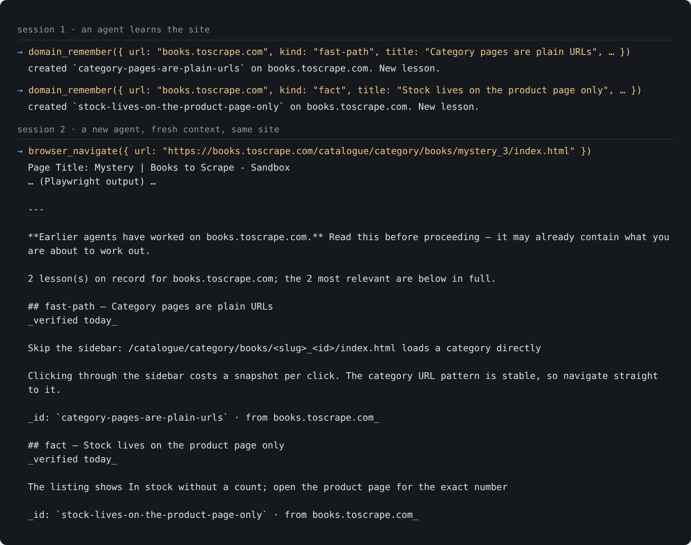

# browser-memory

**One MCP gateway that gives AI agents a real browser and a memory per website.**
It proxies every tool of [Playwright MCP](https://github.com/microsoft/playwright-mcp)
and adds what an agent learns on each site: shortcuts, fixes, dead ends, and
the site's own internal API, observed from real traffic. The next agent that
lands on the same site starts where the last one stopped.

[עברית](README.he.md)



A real run against a public sandbox site, with an isolated headless browser
and an empty memory directory. Session 1 records two lessons. Session 2 is a
fresh agent; when it navigates to the site, the gateway attaches the lessons to
the navigation result on its own.

---

## Why it is interesting

- **Memory that arrives without being asked for.** An agent that sees two
  servers has to decide by itself when to consult memory, and in practice it
  does not. A gateway sits in the path, so it injects what is known about a
  domain the first time the session reaches it.
- **Learned, not written.** Three seconds after each navigation the gateway
  reads the network log, drops telemetry, collapses ids to `:id` and keeps
  parameter names without values. A single visit to an admin panel maps its
  internal API (invoices, subscriptions, resources) with no one writing a line.
  Response bodies are never stored.
- **Capture that does not depend on the agent remembering.** In one measured
  session an agent worked 49 turns across three sites, recorded nothing, and
  reported that it had. The gateway sees every call and result underneath the
  agent's story and infers lessons from evidence: an endpoint that returned
  data, a call that failed and then succeeded after a change, a form flow that
  worked.
- **Lessons become tools.** Something that worked once can be saved as a
  procedure and shows up in the tool list as a regular, callable tool.
- **Fixes that fire by themselves.** Every error body is matched against known
  symptoms, and a fix whose trigger appears verbatim is attached to the error.
  A fix that failed in its last two runs is not offered.
- **Measured, not assumed.** `npm run eval:compare` runs the same real task
  against an empty memory and a mature one. On a two-site task (match every
  VPS on a hosting panel with every DNS zone on a CDN), four of four pairs
  moved the same way: median turns 15.5 → 12.5, time 105 s → 73.5 s, cost
  $0.91 → $0.74. The Hebrew README has the full tables, the ablation campaign,
  and what the numbers cannot claim (n = 4, overlapping ranges).

## Architecture

```
Chrome (one persistent profile, CDP 9222)
      ▲
playwright-mcp (HTTP)                  ← upstream, untouched
      ▲
browser-gateway (stdio)                ← the agent connects here, and only here
      │
      ├── memory/<domain>.json             lessons
      ├── memory/api/<domain>.json         the API observed on the wire
      ├── memory/procedures/<domain>.json  saved procedures, served as tools
      ├── memory/observations.jsonl        evidence for automatic capture
      ├── memory/audit.jsonl               every call, written underneath the agent
      └── memory/tabs.json                 tab ownership, survives a kill
```

```
src/
  gateway/     the MCP server: tool list, dispatch, the brief attached on arrival
  memory/      the store, relevance ranking, curation
  capture/     everything written without being asked: observe, evidence, API map, harvest
  browser/     reading and driving the page: aria, tabs, ask-the-user, diagnosis
  procedures/  saved procedures and how they run
  lib/         mechanism with no product opinion: locks, rotation, redaction, audit, trace
  report/      a measured run rendered as a dossier
eval/          real tasks for real agents, cold against warm
```

Lessons have kinds, ordered by how much time they save: `fast-path` (a snippet
that fetches the data directly), `recipe`, `fix` (symptom → solution),
`dead-end`, `auth`, `landmark` (stable selectors and paths) and `fact`.

The memory tools: `domain_brief`, `domain_open`, `domain_unstick`,
`domain_remember`, `domain_report`, `domain_forget`, `domain_index`,
`domain_interface`, `domain_curate`, `procedure_draft`, `procedure_save`,
`procedure_list`, `procedure_delete`, and `browser_ask_user` for the moments
only a person can handle (a CAPTCHA, a login code, a card number).

## Running it

Requirements: Node.js 24 (the code is TypeScript run directly by Node) and a
running Playwright MCP server.

```bash
npm ci

# An isolated headless browser for trying it out. Both processes must name
# the same output directory: the gateway reads the snapshots the upstream writes.
npx @playwright/mcp --port 8931 --headless --isolated --output-dir /tmp/bm-output

# The gateway, as an MCP server over stdio:
PLAYWRIGHT_MCP_URL=http://localhost:8931/mcp \
PLAYWRIGHT_MCP_OUTPUT_DIR=/tmp/bm-output \
BROWSER_MEMORY_DIR=./memory \
node src/gateway/index.ts
```

In this mode memory, the API map and capture all work. Tab ownership and
`browser_ask_user` also talk to Chrome over CDP (`BROWSER_CDP_URL`); for those,
run a persistent Chrome with `--remote-debugging-port=9222` and point the
upstream at it with `--cdp-endpoint http://127.0.0.1:9222`, the setup in the
diagram above.

Add it to Claude Code (or any MCP client) as a stdio server:

```bash
claude mcp add browser -- node /path/to/browser-memory/src/gateway/index.ts
```

| Variable | Default | What |
|---|---|---|
| `PLAYWRIGHT_MCP_URL` | `http://localhost:8931/mcp` | the upstream Playwright MCP |
| `PLAYWRIGHT_MCP_OUTPUT_DIR` | `output/` inside `BROWSER_WORK_DIR` | where the upstream writes snapshots; must match its `--output-dir` |
| `BROWSER_CDP_URL` | `http://127.0.0.1:9222` | Chrome's debugging endpoint, for tab ownership and asking the user |
| `BROWSER_MEMORY_DIR` | `memory/` inside the package | where lessons, API maps and logs live |
| `BROWSER_WORK_DIR` | `work/` beside the checkout | screenshots, downloads, snapshots |
| `BROWSER_MEMORY_WITHOUT` | empty | switch layers off, for ablation runs |
| `EVAL_INBOX` | none | required for `npm run eval -- --side-effects`: the signed-in Gmail address the errands mail to |

## Tests and tools

```bash
npm run test:unit     # no browser needed
npm run test:browser  # against a live Chrome, under a lock
npm run typecheck

npm run watch         # the gateway's decisions, live, in a second terminal
npm run explain       # what is being served right now, grouped by origin
npm run eval:compare  # the same task against cold and warm memory
```

## License

[MIT](LICENSE)
